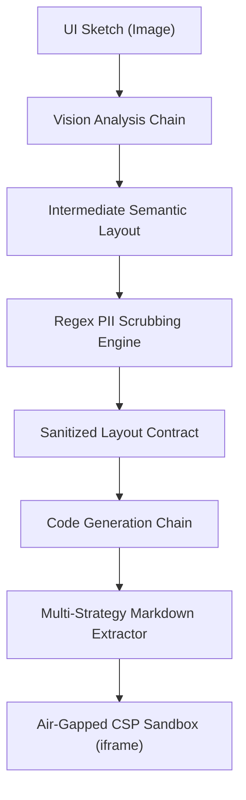

# RoboUI: On-Device Sketch-to-Code Web Generator

RoboUI converts hand-drawn UI sketches into runnable HTML and Tailwind web applications. It runs locally using 4-bit quantized GGUF weights or a zero-weight mock engine, with LangChain managing the two-stage vision and code generation pipeline.



## System Workflow

1. **Vision Analysis**: Inspects uploaded wireframe drawings to extract layout containers, navigation elements, and structural hierarchy.
2. **PII Scrubbing**: Strips credentials, API tokens, email addresses, and network identifiers from the intermediate text before code synthesis.
3. **Code Generation**: Emits responsive HTML with utility styling and vanilla JavaScript.
4. **Air-Gapped Isolation**: Renders generated code inside an `iframe` with a strict Content Security Policy (`default-src 'none'`) and local CSS inlining.

---

## Architectural Trade-offs: On-Device vs. Cloud API

| Evaluation Metric | On-Device Gemma (4-bit GGUF) | Cloud API (Proprietary Vision) |
| :--- | :--- | :--- |
| **Data Privacy** | Air-gapped. Zero bytes leave the local host. | Requires transmitting raw user sketches over public networks. |
| **Operational Cost** | Fixed hardware investment; zero marginal token cost. | Variable per-call pricing and vendor lock-in. |
| **VRAM Footprint** | Fits in 4 GB to 8 GB consumer GPU memory or CPU fallback. | Offloaded entirely to vendor infrastructure. |
| **Context Limits** | 2,048 to 4,096 token limit requiring strict prompt throttling. | 128,000+ token context windows. |
| **Output Repair** | Requires regex auto-closing for truncated code blocks. | High-capacity models rarely truncate structural tags. |

---

## Local Model Setup

RoboUI ships with a built-in mock engine enabled by default (`ROBOUI_MOCK_MODE=true`). To run local quantized inference:

1. Install llama-cpp-python with your platform hardware backend:
   ```bash
   pip install llama-cpp-python
   ```

2. Place your 4-bit quantized model weights in the `models/` directory:
   ```bash
   mkdir -p models
   # Example: Download Gemma-2B or PaliGemma GGUF weights
   # Place as models/gemma-2b-instruct-q4.gguf
   ```

3. Update `.env` or set environment variables:
   ```bash
   ROBOUI_MOCK_MODE=false
   ROBOUI_MODEL_PATH=models/gemma-2b-instruct-q4.gguf
   ROBOUI_N_GPU_LAYERS=33
   ROBOUI_MAX_CONTEXT_TOKENS=2048
   ```

---

## Development & Test Suite

Create a virtual environment and execute the automated verification suite:

```bash
python -m venv .venv
source .venv/bin/activate  # Or on Windows: .venv\Scripts\activate
pip install -r requirements.txt
pytest tests/ -v
```

Launch the Streamlit interface:

```bash
streamlit run roboui/app.py
```
